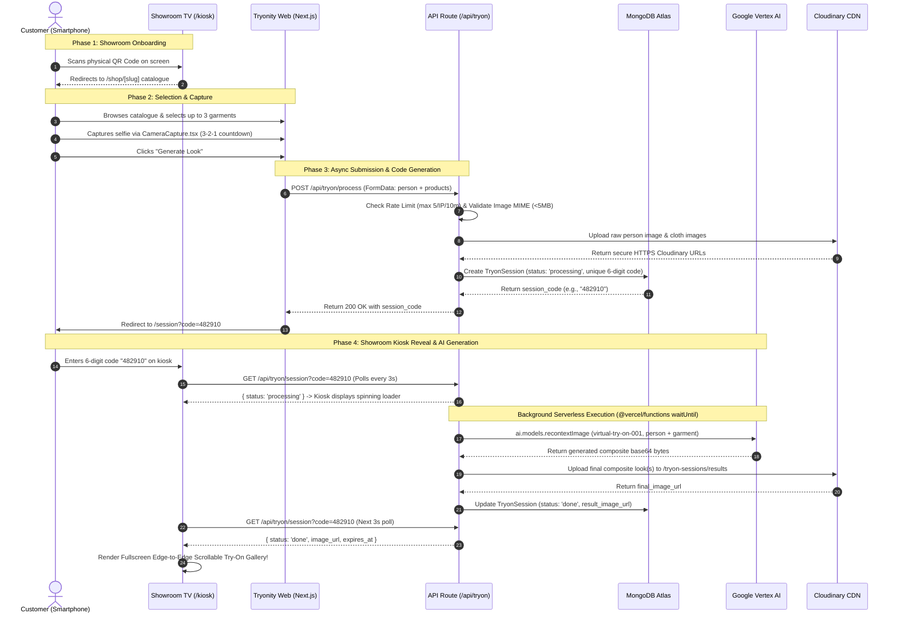

# TRYONITY — Exhaustive Production System & UI/UX Design Specification

**Document Version:** 1.0.0  
**Target Architecture:** Production Release (Next.js 14 App Router, TypeScript, MongoDB Atlas, Google Vertex AI, Cloudinary, NextAuth.js v5)  
**Design System:** Tryonity Neobrutalism (Playful Brutalism)  

---

## Table of Contents

1. [Executive Summary & Problem Statement](#1-executive-summary--problem-statement)
2. [The Tryonity Solution & Core Ecosystem](#2-the-tryonity-solution--core-ecosystem)
3. [Complete Website Functional & Architectural Breakdown](#3-complete-website-functional--architectural-breakdown)
   - [3.1 System Architecture & Data Flow](#31-system-architecture--data-flow)
   - [3.2 Route-by-Route Feature Inventory](#32-route-by-route-feature-inventory)
   - [3.3 Current Operational Behavior vs. Supposed Technical Capabilities](#33-current-operational-behavior-vs-supposed-technical-capabilities)
4. [Detailed End-to-End Customer & Owner Workflows](#4-detailed-end-to-end-customer--owner-workflows)
   - [4.1 Customer Showroom Journey (Step-by-Step)](#41-customer-showroom-journey-step-by-step)
   - [4.2 Showroom Owner & Staff Workflow](#42-showroom-owner--staff-workflow)
   - [4.3 Interactive Workflow Sequence Diagram](#43-interactive-workflow-sequence-diagram)
5. [Exhaustive UI/UX Design System Specification (Section-by-Section Analysis)](#5-exhaustive-uiux-design-system-specification-section-by-section-analysis)
   - [5.1 Design Philosophy: Neobrutalism (Playful Brutalism)](#51-design-philosophy-neobrutalism-playful-brutalism)
   - [5.2 Global Design Tokens & Tailwind System](#52-global-design-tokens--tailwind-system)
   - [5.3 Section-by-Section Precise UI/UX & Component Architecture Analysis](#53-section-by-section-precise-uiux--component-architecture-analysis)
6. [Security, Performance, and Error Recovery Protocols](#6-security-performance-and-error-recovery-protocols)

---

## 1. Executive Summary & Problem Statement

### 1.1 The Retail Showroom Dilemma
Physical clothing showrooms and boutique retail stores face chronic operational bottlenecks that directly erode sales conversion rates and customer satisfaction:
- **Fitting Room Bottlenecks & Long Queues:** Peak shopping hours create long waiting lines outside limited physical fitting rooms. Customers who experience wait times exceeding 5–10 minutes frequently abandon their intended purchases.
- **Garment Wear-and-Tear & Soiling:** Repeated physical try-ons expose high-value clothing to makeup stains, sweat, stretching, zipper damage, and general fabric degradation, leading to significant inventory shrinkage and dry-cleaning overhead.
- **Inventory Displacement & Staff Restocking Burden:** When customers take multiple garments into fitting rooms and reject them, showroom staff must spend considerable labor sorting, refolding, and returning items to the sales floor.
- **Limited Customer Exploration (The Try-On Ceiling):** Because physical try-on is laborious, the average customer only tries on 2 to 4 items per store visit. This creates a hard ceiling on cross-selling, up-selling, and serendipitous discovery.

### 1.2 The Shortcomings of Digital-Only Solutions
While e-commerce virtual try-on tools exist, they are historically disconnected from physical retail:
- **High Friction Mobile Apps:** Requiring shoppers to download a proprietary app inside a store creates immediate drop-off due to poor cellular connectivity, app store passwords, and download latency.
- **Isolated Experiences:** Traditional AR filters on a smartphone screen are small and private; they fail to create the collaborative, high-impact showroom experience that drives group validation and purchasing confidence.

---

## 2. The Tryonity Solution & Core Ecosystem

### 2.1 The Tryonity Concept
**Tryonity** is a production-ready **Virtual Try-On Web Ecosystem** designed specifically for clothing showrooms. It transforms the physical retail floor by pairing **customer self-service mobile web browsing** with **large showroom kiosk displays** powered by generative artificial intelligence.

```
+-----------------------------------------------------------------------------------+
|                            THE TRYONITY ECOSYSTEM                                 |
+-----------------------------------------------------------------------------------+
|                                                                                   |
|  +--------------------+         QR Code Scan         +-------------------------+  |
|  |                    | ---------------------------> |                         |  |
|  |  Showroom Kiosk    |                              |   Customer Smartphone   |  |
|  |  (Large TV Screen) | <--------------------------- |   (Zero-App Web App)    |  |
|  |                    |       6-Digit Code Enter     |                         |  |
|  +--------------------+                              +-------------------------+  |
|            ^                                                      |               |
|            | 3-Second Async Polling                               | Upload Image  |
|            v                                                      v               |
|  +-----------------------------------------------------------------------------+  |
|  |                       NEXT.JS 14 BACKEND PLATFORM                           |  |
|  |     (API Routes, Mongoose ODM, MongoDB Atlas, NextAuth.js v5 Security)     |  |
|  +-----------------------------------------------------------------------------+  |
|            |                                                      ^               |
|            | Async Background AI Execution                        | Store Result  |
|            v                                                      |               |
|  +--------------------+                              +-------------------------+  |
|  |  Google Vertex AI  |                              |     Cloudinary CDN      |  |
|  | (recontextImage /  | ---------------------------> | (High-Res Asset Store & |  |
|  | virtual-try-on-001)|        Base64 to CDN         |  Optimized Delivery)    |  |
|  +--------------------+                              +-------------------------+  |
|                                                                                   |
+-----------------------------------------------------------------------------------+
```

### 2.2 Core Innovations
1. **Zero-App QR Code Onboarding:** Customers scan a physical QR code at the showroom entrance or kiosk screen using their standard phone camera. No mobile app download or account registration is required.
2. **Multi-Item & Single-Item Try-On Modes:** Customers can select a single garment or combine up to **3 items simultaneously** (e.g., shirts, trousers, jackets) from the digital catalogue, or even upload a photo of a physical garment off the rack.
3. **Live Camera & Selfie Upload:** The platform features an integrated live web camera capture interface (`CameraCapture.tsx`) alongside standard photo uploads, supporting front-facing selfies and rear camera garment captures.
4. **Synchronized Showroom Kiosk Reveal:** Upon submitting a try-on request, the user receives a unique **6-digit numeric session code**. When entered into any large showroom kiosk display (`/kiosk`), the screen reveals an edge-to-edge, high-definition AI-generated look.
5. **Generative AI Realism:** Powered by **Google Vertex AI (`virtual-try-on-001` multimodal image recontextualization model)**, Tryonity preserves the customer's body pose, facial identity, skin tone, and background while draping the selected garment with realistic fabric physics, shadows, and lighting.

---

## 3. Complete Website Functional & Architectural Breakdown

### 3.1 System Architecture & Data Flow
- **Framework:** **Next.js 14** utilizing the **App Router** (`app/`), **Server Components**, and **API Routes**.
- **Database Layer:** **MongoDB Atlas** accessed via **Mongoose ODM** with strongly typed schemas (`Shop`, `Product`, `TryonSession`, `User`).
- **Authentication & Authorization:** **NextAuth.js v5 (beta.31)** implementing JSON Web Token (JWT) sessions and server-side route protection for showroom owners.
- **Storage Layer:** **Cloudinary** for scalable cloud storage of raw customer uploads, catalogue product imagery, and final AI try-on composite results.
- **AI Processing Engine:** **Google Vertex AI SDK (`@google/genai`)** calling `ai.models.recontextImage`. The process runs inside background serverless execution (`@vercel/functions` `waitUntil`) with up to 60-second timeouts to handle parallel image generation without HTTP connection drops.
- **Rate Limiting & Security:** Integrated token bucket rate-limiting (`lib/rate-limit.ts`) allowing **5 try-on requests per IP address per 10-minute window**, protecting backend AI compute budgets and preventing denial-of-service abuse.

### 3.2 Route-by-Route Feature Inventory

| Route Path | Access Level | Description & Architectural Role |
| :--- | :--- | :--- |
| `/` | Public | **Marketing & Landing Page:** Highlights system features, ROI for showroom owners, AI demonstration visual elements, and primary call-to-action buttons. |
| `/login` | Public | **Owner Login:** NextAuth credentials provider authentication form for existing showroom owners. |
| `/signup` | Public | **Owner Registration:** Creates a new showroom owner account, provisions a unique `Shop` document in MongoDB, and generates default branding. |
| `/dashboard` | Protected (Owner) | **Owner Overview:** Displays live operational statistics: Total Active Products, Processing/Active Try-On Sessions, and Total Try-Ons Today. |
| `/dashboard/products` | Protected (Owner) | **Catalogue Management:** Tabular interface to view, edit, filter, or remove clothing items in the shop's inventory. |
| `/dashboard/products/new` | Protected (Owner) | **Product Creator:** Form to upload primary and secondary clothing photos to Cloudinary, assign categories (`shirt`, `kurta`, `jacket`, `trouser`, `suit`, `other`), set pricing, and designate available sizes (`XS` through `3XL`). |
| `/dashboard/shop` | Protected (Owner) | **Shop Settings & QR Code Generator:** Manages shop name, description, logo upload, and dynamically renders a high-contrast QR code canvas (`qrcode` library) with immediate PNG download capability. |
| `/shop/[slug]` | Public (Customer) | **Customer Showroom Catalogue:** Displays the shop's branded storefront, logo, description, category filter chips, and interactive product grid with **Multi-Select (up to 3 garments)** or single "Try On" actions. |
| `/shop/[slug]/product/[id]` | Public (Customer) | **Product Detail View:** Detailed display of a garment's full photo gallery, size selector, price, and direct launch button into the Try-On upload flow. |
| `/shop/[slug]/tryon` | Public (Customer) | **Virtual Try-On Upload Flow:** Two-mode garment selection (Catalogue Preselection vs. Upload Own Cloth) and two-mode person photo acquisition (File Upload vs. Live Web Camera Capture via `CameraCapture.tsx`). |
| `/shop/[slug]/session` | Public (Customer) | **Single-Session Live Tracker:** Displays the **6-digit numeric session code** in an ultra-high-contrast block, live status badges (`Processing...`, `Result Ready!`), countdown timer (10-minute expiry), and auto-polling every 3 seconds. |
| `/shop/[slug]/session-multi` | Public (Customer) | **Multi-Session Live Tracker:** Handles multiple concurrent session codes (`?codes=123456,654321`), polling each code in parallel and showing side-by-side status progress. |
| `/kiosk` | Public (Showroom TV) | **Showroom Kiosk Display Screen:** The flagship showroom presentation screen operating across 4 real-time reactive states (`idle`, `processing`, `result`, `error`). |

### 3.3 Current Operational Behavior vs. Supposed Technical Capabilities
- **Current Operational State:**
  - Fully integrated with **Google Vertex AI (`virtual-try-on-001`)** for authentic generative AI try-on generation.
  - Multi-garment try-on processes each selected product in parallel (`Promise.all` over `clothImageUrls`), uploading results to Cloudinary and writing comma-separated URLs to MongoDB `result_image_url`.
  - Showroom kiosk polling operates at **3,000ms intervals**, seamlessly transitioning from `idle` to `processing` and rendering an interactive horizontal gallery when status changes to `done`.
  - Sessions automatically expire after **10 minutes** (`expires_at`), freeing memory and ensuring customer privacy on public kiosk screens.
- **Supposed Technical Capabilities & Phase 2 Roadmap:**
  - *Automated Checkout Integration:* Allow customers to scan a generated look on the kiosk and instantly send the items to an in-store Point of Sale (POS) system or mobile payment gateway.
  - *Customer Wardrobe History:* Enable optional customer SMS/email sign-in to save generated try-on lookbooks to a persistent personal profile.
  - *Advanced Body Measurement Estimation:* Combine Vertex AI segmentation with depth camera input to recommend precise garment sizing (e.g., "Size M Recommended").

---

## 4. Detailed End-to-End Customer & Owner Workflows

### 4.1 Customer Showroom Journey (Step-by-Step)
1. **Showroom Entrance & Discovery:** The customer walks into a retail showroom and observes a large TV screen (`/kiosk`) displaying "Virtual Try-On" and a prominent QR code.
2. **Instant Mobile Connect:** The customer scans the kiosk QR code (or shelf-tag QR code) with their smartphone camera. The mobile browser instantly opens `https://tryonity.demo/shop/tryonity-demo` without any app installation.
3. **Catalogue Exploration & Multi-Selection:**
   - The customer browses the digital catalogue, filtering by category (e.g., `Shirts`, `Kurtas`, `Jackets`).
   - The customer clicks on product cards to toggle **Multi-Select mode** (up to 3 items) or selects a single product and taps `"Try On Selected Items"`.
4. **Person Image Acquisition:**
   - On `/shop/[slug]/tryon`, the customer chooses to either upload an existing full-body photo from their camera roll or tap **"Take a Photo"**.
   - If **"Take a Photo"** is tapped, the Neobrutalist `CameraCapture.tsx` modal opens. The customer uses the front-facing selfie camera (automatically mirrored for visual comfort) or rear camera, observes the 3-2-1 countdown, and captures a high-resolution snapshot.
5. **Session Code Assignment:**
   - Upon clicking **"Generate Look"**, the client validates MIME types (`JPG`, `PNG`, `WebP`) and file sizes (<5MB), then submits a `FormData` payload to `/api/tryon/process`.
   - The server assigns a unique **6-digit numeric code** (e.g., `482 910`) and redirects the mobile browser to `/shop/[slug]/session?code=482910`.
6. **Kiosk Screen Synchronized Reveal:**
   - The customer walks up to the showroom TV kiosk screen and enters `482910` using their smartphone or kiosk touchscreen/keypad.
   - The kiosk transitions to the **Processing State**, displaying spinning Neobrutalist rings and *"Generating your look... ~8 seconds"*.
   - Once Google Vertex AI completes the composite, the kiosk transitions to the **Result State**, revealing a stunning fullscreen image gallery. If multiple items were selected, the customer can scroll or click navigation arrows to inspect Look 1, Look 2, and Look 3 on the big screen.

### 4.2 Showroom Owner & Staff Workflow
1. **Account Registration:** The store manager registers at `/signup` with their showroom name and email.
2. **Branding Configuration:** Inside `/dashboard/shop`, the manager uploads a high-resolution shop logo and sets a custom shop description.
3. **Kiosk Deployment:**
   - The manager clicks **"Download QR Code"** to export an error-correction-hardened PNG QR code for print display.
   - The showroom TV browser is opened and navigated to `/kiosk?shop=shop-slug`, locking it into fullscreen display mode.
4. **Inventory Management:** Staff add physical store garments via `/dashboard/products/new`, uploading clear product photos that the AI will use as source garment references.

### 4.3 Interactive Workflow Sequence Diagram



---

## 5. Exhaustive UI/UX Design System Specification (Section-by-Section Analysis)

### 5.1 Design Philosophy: Neobrutalism (Playful Brutalism)
Tryonity explicitly rejects generic "minimalist corporate SaaS" aesthetics in favor of a curated, high-impact **Neobrutalist (Playful Brutalism)** design language. 

#### Why Neobrutalism for a Clothing Showroom?
- **Tactile Clarity in Showroom Environments:** Retail showrooms have bright overhead spotlights, glare, and varied viewing distances. Neobrutalism’s **thick 4px solid black borders**, **crisp white cards**, and **hard-edge drop shadows** create unmistakable visual boundaries that can be read from 15 feet away.
- **Unambiguous Interactive Feedback:** Every button, filter chip, and input box behaves like a physical switch. Hovering lifts an element upward (`hover:-translate-y-1`) while increasing shadow spread; pressing it down physically depresses the element (`active:translate-y-1 active:shadow-none`), providing instant tactile satisfaction on mobile touchscreens and kiosk terminals.
- **Vibrant Fashion Energy:** Curated, joyful accent colors (Electric Yellow, Neon Green, Cyan, Hot Magenta, and Coral Red) invoke a modern streetwear and high-fashion editorial vibe.

### 5.2 Global Design Tokens & Tailwind System
The entire design system is codified inside `tailwind.config.ts` and `app/globals.css`.

#### Complete Color Palette & Token Definitions

| Token Name | Hex Code | Visual Swatch | Semantic Usage & Architectural Application |
| :--- | :--- | :--- | :--- |
| `tryonity-bg` | `#fffce1` | **Creamy Yellow** | Primary background color for all public and customer catalogue pages. |
| `tryonity-surface` | `#ffffff` | **Crisp White** | Background for content cards, navigation bars, and product panels. |
| `tryonity-surface2`| `#f0f0f0` | **Light Gray** | Subtle contrast background for image placeholders and secondary cards. |
| `tryonity-border`  | `#000000` | **Pitch Black** | 4px solid borders on cards, buttons, badges, and input fields. |
| `tryonity-text`    | `#000000` | **Pitch Black** | Primary body text, page titles, and uppercase headings. |
| `tryonity-muted`   | `#333333` | **Charcoal** | Subtitle text, secondary explanations, and kiosk metadata labels. |
| `tryonity-subtle`  | `#666666` | **Medium Gray** | Hints, form placeholder text, and timestamps. |
| `tryonity-accent`  | `#ff5757` | **Bright Red Accent**| Primary CTA buttons, active selection badges, and kiosk loading rings. |
| `accent-hover`     | `#e04848` | **Deep Red Accent**  | Hover state for primary red action buttons. |
| `accent-dim`       | `#ffaaaa` | **Soft Pink Accent** | Disabled or background tint states for accent elements. |
| *Neo Yellow*       | `#ffde59` | **Electric Yellow**  | Hero badges, processing status pills, and Kiosk code display text. |
| *Neo Green*        | `#00cc00` | **Neon Green**       | Live operational indicators, success status badges, and signup CTAs. |
| *Neo Cyan*         | `#00ffff` | **Electric Cyan**    | Feature card highlights and decorative landing page blocks. |
| *Neo Magenta*      | `#ff00ff` | **Hot Magenta**      | Feature card highlights and decorative landing page blocks. |
| *Kiosk Black*      | `#000000` | **Deep Black**       | Fullscreen background for the showroom kiosk TV screen. |

#### Box Shadow & Border Radius Tokens
```css
/* Corner Radius */
border-radius: 'neo' (0.5rem / 8px)  -- Slightly rounded, architectural corners

/* Neobrutalist Hard Shadows (Zero Blur, Solid Black) */
box-shadow: 'neo-sm' -> 2px 2px 0px 0px rgba(0,0,0,1)  -- For badges, chips, small icons
box-shadow: 'neo'    -> 4px 4px 0px 0px rgba(0,0,0,1)  -- For standard cards, buttons, inputs
box-shadow: 'neo-lg' -> 8px 8px 0px 0px rgba(0,0,0,1)  -- For hero CTA buttons & modal panels
```

#### Reusable Utility Components (`app/globals.css`)
- `.btn-primary`: Bright red accent background (`bg-tryonity-accent`), black font (`font-extrabold`), 4px black border (`border-4 border-black`), `shadow-neo`, with hover lift and active depression.
- `.btn-secondary`: Crisp white background (`bg-tryonity-surface`), black font, 4px black border, `shadow-neo`, with hover lift and active depression.
- `.input-field`: White background, 4px black border, `rounded-neo`, bold text, with focus lift (`focus:-translate-y-0.5 focus:shadow-neo`).
- `.card` & `.card-hover`: Solid white surface, 4px black border, `shadow-neo`. The hover variant elevates to `shadow-neo-lg` and translates `-translate-y-1`.
- `.label`: Uppercase tracking-widest text with a solid 2px black underline (`border-b-2 border-black inline-block`).
- `.badge`: Inline bold pill with a 2px black border and `shadow-neo-sm`.

---

### 5.3 Section-by-Section Precise UI/UX & Component Architecture Analysis

#### 5.3.1 Public Landing Page (`app/page.tsx`)
- **Top Navigation Bar:**
  - Sticky header (`sticky top-0 z-50`) with a white background, bottom 4px solid black border, and `shadow-neo-sm`.
  - Left side features a 40x40px red accent square logo icon with a 4px black border and black SVG icon, beside the uppercase `TRYONITY` brand title in `font-black text-2xl tracking-tighter`.
  - Right side houses an uppercase `"Login"` text link (`decoration-4 underline-offset-4`) and a `"Get Started"` primary Neobrutalist button.
- **Hero Section:**
  - Two-column responsive layout (`max-w-6xl mx-auto py-20 md:py-32`).
  - Left column features a rotated badge (`bg-[#ffde59] transform -rotate-2 border-4 border-black px-4 py-2`) reading `"EMPOWER YOUR SHOWROOM"`.
  - Main headline (`text-6xl md:text-8xl font-black uppercase tracking-tighter leading-[0.9]`) includes a crisp white text drop shadow (`drop-shadow-[4px_4px_0px_#fff]`).
  - Subtitle is anchored by an 8px solid red accent left border (`border-l-8 border-tryonity-accent pl-6 bg-white/50`).
  - CTA Button Group features 3 distinct buttons:
    1. `"SIGNUP NOW"` in Neon Green (`#00cc00`) with an 8px hard black shadow (`shadow-neo-lg`).
    2. `"OWNER LOGIN"` in Electric Yellow (`#ffde59`).
    3. `"EXPLORE"` in Crisp White (`bg-white`) with an SVG compass icon.
- **Decorative Hero Graphic:**
  - An architectural offset card stack using 3 layered Neobrutalist blocks: magenta bottom card (`#ff00ff`, translated `4px, 4px`), cyan middle card (`#00ffff`, translated `2px, 2px`), and a crisp white top card featuring a 128x128px spark SVG icon and `"AI TRY-ON COMING TO LIFE"`.
- **Features Showcase Section:**
  - Grid of 3 multi-colored cards (`bg-[#ffde59]`, `bg-[#00ffff]`, `bg-[#ff00ff]`), each wrapped in 4px black borders with `shadow-neo-lg` and hover lift (`hover:-translate-y-2`).
  - Each card includes a 64x64px white icon badge (`w-16 h-16 border-4 border-black shadow-neo-sm`) with bold emoji symbols (⚡, 📱, 📊) and bold charcoal/white descriptive text.
- **Footer:**
  - Solid black background (`bg-black text-white`) separated by a top 4px black border, featuring the Tryonity logo and copyright information.

```
+-----------------------------------------------------------------------------------+
| [Logo] TRYONITY                                            Login   [Get Started]  | <-- Navigation (Sticky, 4px border)
+-----------------------------------------------------------------------------------+
|   /-------------------------\                                                     |
|   |  EMPOWER YOUR SHOWROOM  |  (-2 deg rotated #ffde59 badge)                     |
|   \-------------------------/                                                     |
|                                                                                   |
|   THE FUTURE OF                       +---------------------------------------+   |
|   VIRTUAL TRY-ON                      |   +-------------------------------+   |   |
|                                       |   |   +-----------------------+   |   |   | <-- Layered Neobrutalist
|   | Let your customers try on clothes |   |   |        [Spark SVG]    |   |   |   |     Card Stack (#ff00ff,
|   | instantly using AI. Zero fitting  |   |   |   AI TRY-ON COMING    |   |   |   |     #00ffff, and White)
|   | rooms. Zero hassle...             |   |   |       TO LIFE         |   |   |   |
|                                       |   |   +-----------------------+   |   |   |
|   [ SIGNUP NOW ]  [ OWNER LOGIN ]     |   +-------------------------------+   |   |
|                                       +---------------------------------------+   |
+-----------------------------------------------------------------------------------+
```

---

#### 5.3.2 Customer Showroom Catalogue (`components/catalogue/CatalogueClient.tsx`)
- **Storefront Branded Header:**
  - Sticky top header (`bg-tryonity-bg border-b-4 border-tryonity-border shadow-neo-sm`) displaying the showroom logo inside a 48x48px white card (`border-4 border-black rounded-neo`).
  - Displays the store title in `font-black text-2xl uppercase` and shop description.
  - Sub-banner features a **Neon Green Live Indicator Square** (`w-3 h-3 bg-[#00cc00] border-2 border-black`) next to `"VIRTUAL TRY-ON"`.
  - Right-aligned **Selection Counter Pill**: When items are selected, a badge appears (`bg-tryonity-accent text-black border-2 border-black shadow-neo-sm`) reading `"1/3 SELECTED"`.
- **Horizontal Scrolling Filter Chips:**
  - A scrollable ribbon (`overflow-x-auto scrollbar-none border-b-4 border-black bg-white shadow-[0_4px_0_0_rgba(0,0,0,1)] z-10`).
  - Each category chip (`All`, `Shirts`, `Kurtas`, `Jackets`, `Trousers`, `Suits`, `Other`) is rendered as a Neobrutalist button with `border-4 border-black shadow-neo-sm`.
  - Active chip transforms to **Bright Red Accent** (`bg-tryonity-accent text-black`) while inactive chips remain crisp white (`bg-white hover:bg-[#f0f0f0]`).
- **Multi-Select Guidance Banner:**
  - When 0 items are selected, a bright yellow alert card (`bg-[#ffde59] border-4 border-black shadow-neo-sm mx-4 mt-4`) displays a bold SVG bulb icon and `"TIP: TAP + TO SELECT UP TO 3 ITEMS AND TRY THEM ALL ON AT ONCE!"`.
- **Product Grid Layout:**
  - Responsive multi-column grid (`grid-cols-2 md:grid-cols-3 lg:grid-cols-4 xl:grid-cols-5 gap-4 px-4 py-6`).
  - **Product Card (`.card-hover`):** 
    - Solid white card with 4px black borders.
    - Image container uses `aspect-[3/4] bg-[#f0f0f0]` with subtle grayscale filtering (`grayscale-[10%]`) that snaps to full color (`grayscale-0`) when selected.
    - Bottom action section features the product title (`font-black text-sm uppercase`), price formatted in INR/USD (`text-tryonity-subtle font-bold`), and an interactive selection button (`+` icon or checkmark).
    - When selected, the entire card highlights with a thick double outline (`ring-4 ring-black ring-offset-2 shadow-neo`).
- **Floating Bottom Action Bar (Multi-Try-On Launcher):**
  - When `selectedCount > 0`, a fixed bottom bar slides up (`fixed bottom-0 left-0 right-0 p-4 bg-white border-t-4 border-black shadow-[0_-4px_0_0_rgba(0,0,0,1)] z-30 animate-slide-up`).
  - Features a massive primary CTA button (`btn-primary bg-[#00cc00] text-black text-lg py-5`) reading `"TRY ON 2 ITEMS NOW →"`.

---

#### 5.3.3 Customer Product Detail View (`components/catalogue/ProductDetailClient.tsx`)
- **Breadcrumb & Header:**
  - Top back navigation button (`btn-ghost`) reading `"← BACK TO CATALOGUE"`.
- **Garment Showcase Column:**
  - Large primary image frame (`border-4 border-black rounded-neo shadow-neo bg-white aspect-[3/4] overflow-hidden`).
  - Sub-gallery row of thumbnail cards below; clicking any thumbnail highlights it with a 4px black border and swaps the primary image.
- **Product Specifications & Actions Column:**
  - Category badge (`badge bg-[#ffde59] text-black mb-3`).
  - Product title in `font-black text-4xl uppercase` and price in `font-extrabold text-2xl text-tryonity-accent`.
  - **Size Selector:** Displays sizes (`XS`, `S`, `M`, `L`, `XL`, `2XL`, `3XL`). Each size is a clickable 40x40px badge; the selected size fills with solid black (`bg-black text-white border-4 border-black shadow-neo-sm`).
  - Primary `"TRY ON THIS GARMENT →"` red accent CTA button (`btn-primary text-xl py-5 shadow-neo-lg`).

---

#### 5.3.4 Virtual Try-On Upload Flow (`components/tryon/TryOnClient.tsx` & `CameraCapture.tsx`)
- **Two-Column Selection Interface:**
  - Left column: **Person Photo Input (`UploadZone`)**.
  - Right column: **Garment Selection (`UploadZone` or Preselected Summary Card)**.
- **Neobrutalist Upload Dropzones (`UploadZone`):**
  - Card style: `border-4 border-tryonity-border bg-[#ffffff] hover:bg-tryonity-accent rounded-neo shadow-neo transition-all py-14 px-6`.
  - During drag-over, the card dynamically transitions to a dashed border with a red accent fill (`border-dashed bg-tryonity-accent`).
  - Once an image is selected, the dropzone converts into a 3/4 aspect ratio preview card with a floating `"TAP TO CHANGE"` overlay and a top-right edit button (`w-10 h-10 bg-white border-4 border-black rounded-neo shadow-neo-sm`).
  - **Error Display:** If an invalid file type or file >5MB is selected, the dropzone turns bright red (`border-4 border-tryonity-error bg-red-100 shadow-neo`) with an explicit error message.
- **Live Web Camera Capture Modal (`CameraCapture.tsx`):**
  - Launched by clicking **"TAKE A PHOTO"** (`border-4 border-black rounded-neo bg-white text-black font-black uppercase shadow-neo-sm`).
  - Modal overlay renders a fullscreen or centered video viewfinder (`w-full aspect-[3/4] border-4 border-black rounded-neo overflow-hidden bg-black`).
  - **Camera Controls:**
    - Top bar: Camera toggle button (`"user"` front selfie camera vs. `"environment"` rear camera) and `"X"` close button.
    - Viewfinder logic automatically applies CSS horizontal mirroring (`scale(-1, 1)`) when the front camera is active so the customer's reflection behaves like a standard mirror.
    - Bottom bar: Massive 80x80px circular white shutter button with a 4px black border and `shadow-neo`.
  - **3-2-1 Countdown Animation:** Clicking the shutter initiates a 3-second visual countdown (`setCountdown(3)`), rendering huge animated numbers over the center of the video before triggering `canvas.drawImage()` to capture a 0.92 quality JPEG blob.
- **Garment Source Options:**
  - Users can switch between **"Catalogue Garment"** (displaying the preselected item's card with price and size) and **"Upload Custom Garment"** (allowing them to upload an external garment photo).
- **Submission Action Bar:**
  - Sticky bottom submit button (`btn-primary bg-[#00cc00] text-black text-2xl py-6 shadow-neo-lg`): `"GENERATE LOOK (FREE) →"`.
  - While submitting, the button displays an animated spinning black loader and `"UPLOADING & PREPARING..."`.

```
+-----------------------------------------------------------------------------------+
|                         VIRTUAL TRY-ON STUDIO (/tryon)                            |
+-----------------------------------------------------------------------------------+
|                                                                                   |
|        STEP 1: YOUR PHOTO                            STEP 2: SELECTED GARMENT     |
|   +---------------------------+                 +---------------------------+     |
|   |                           |                 |   [ Preselected Item ]    |     |
|   |                           |                 |                           |     |
|   |      [ Camera SVG ]       |                 |   +-------------------+   |     |
|   |       UPLOAD IMAGE        |                 |   |                   |   |     |
|   |  JPG, PNG, WebP (Max 5MB) |                 |   |  Garment Photo    |   |     |
|   |                           |                 |   |  (From Catalogue) |   |     |
|   |                           |                 |   |                   |   |     |
|   +---------------------------+                 |   +-------------------+   |     |
|   | [O] TAKE A PHOTO (WEBCAM) |                 |   Men's Blue Kurta        |     |
|   +---------------------------+                 +---------------------------+     |
|                                                                                   |
|   +---------------------------------------------------------------------------+   |
|   |                 [ GENERATE LOOK (FREE) -> ]  (#00cc00 CTA)                |   |
|   +---------------------------------------------------------------------------+   |
+-----------------------------------------------------------------------------------+
```

---

#### 5.3.5 Session Status Page (`app/shop/[slug]/session/page.tsx` & `session-multi`)
- **Centered Neobrutalist Status Container:**
  - Centered vertical card (`min-h-screen bg-tryonity-bg flex flex-col items-center justify-center px-6 py-12`).
- **Status Indicator Badge:**
  - **Processing State:** A circular 80x80px red spinner (`w-20 h-20 rounded-full bg-tryonity-accent/10 border border-tryonity-accent/20` containing an animated `w-10 h-10 border-4 border-tryonity-accent/20 border-t-tryonity-accent rounded-full animate-spin`).
  - **Done State:** Transforms into a green checkmark badge (`bg-green-950/20 border-green-800/30` with a 40x40px green SVG check).
- **The 6-Digit Session Code Box:**
  - Designed for maximum visual contrast so a customer can read it while holding their phone at arm's length:
  - Solid pitch-black block (`bg-black border-4 border-tryonity-border rounded-3xl px-10 py-8 mb-3 w-full max-w-sm text-center shadow-lg`).
  - Code text rendered in **Electric Yellow** (`text-[#ffde59] font-extrabold tracking-[0.35em] text-5xl tabular-nums select-all`) formatted as pairs (e.g., `4 8 2   9 1 0`).
- **Showroom Kiosk Link & Instructions:**
  - An interactive button (`px-5 py-3 bg-tryonity-surface border border-tryonity-border rounded-2xl hover:border-tryonity-accent`) allowing the customer to test or launch the kiosk display (`"Open Kiosk Screen →"`).
  - Clear guidance text: *"Enter this code on the kiosk screen in the showroom to see your look"*.
- **Live Expiry Countdown Pill:**
  - A dynamic pill (`bg-amber-950/30 border-amber-800/50 text-amber-400 px-4 py-2 rounded-full`) displaying real-time countdown seconds: `"Session expires in 09:42"`.
- **Uploaded Image Thumbnails:**
  - Displays 64x80px preview cards of the customer's uploaded selfie and selected garment side-by-side inside `border border-tryonity-border rounded-xl` frames.
- **Multi-Session View (`session-multi/page.tsx`):**
  - When testing multiple items simultaneously (`?codes=111111,222222`), renders a side-by-side tabbed card interface where each code has its own individual polling indicator and thumbnail reveal.

---

#### 5.3.6 Showroom Kiosk Screen (`app/kiosk/page.tsx`)
The showroom kiosk is the centerpiece of Tryonity’s physical retail presence. It operates as a fullscreen, dark-mode application (`w-screen h-screen bg-black overflow-hidden fixed inset-0`) across 4 distinct visual states:

```
+-----------------------------------------------------------------------------------+
|                        SHOWROOM KIOSK — IDLE STATE (/kiosk)                       |
+-----------------------------------------------------------------------------------+
|                                                                                   |
|                          (*) TRYONITY VIRTUAL TRY-ON (*)                          |
|                             AI-powered fashion preview                            |
|                                                                                   |
|           +------------------------+      |      +-------------------------+      |
|           |                        |      |      |   OR ENTER YOUR CODE    |      |
|           |   +----------------+   |      |      |                         |      |
|           |   |                |   |      |      |   +-----------------+   |      |
|           |   |  LIVE SCANNER  |   |      |      |   | 4  8  2   9  1  0 |   |      |
|           |   |    QR CODE     |   |      |      |   +-----------------+   |      |
|           |   |                |   |      |      |                         |      |
|           |   +----------------+   |      |      |  [  VIEW LOOK  (->)  ]  |      |
|           |                        |      |      +-------------------------+      |
|           |   📱 SCAN TO TRY ON    |      |                                       |
|           +------------------------+      |                                       |
+-----------------------------------------------------------------------------------+
```

##### 1. Idle State (`IdleState`)
- **Branded Header:** Top pulsating red accent dots (`w-4 h-4 bg-tryonity-accent rounded-full animate-pulse`) flanking `"TRYONITY"`, above a 7xl bold title `"Virtual Try-On"`.
- **Left Panel (QR Code Scanner):**
  - Features a high-contrast white card (`bg-white p-4 rounded-2xl shadow-2xl border-4 border-white w-[212px] h-[212px]`) housing an automatically generated 180x180px QR code (`QRCode.toDataURL`).
  - Below the QR code: `"📱 Scan to Try On"` in red accent uppercase tracking-widest text.
- **Center Divider:** A sleek vertical gradient divider (`w-px self-stretch bg-gradient-to-b from-transparent via-tryonity-accent to-transparent`).
- **Right Panel (6-Digit Numeric Input):**
  - Prompts *"Or enter your code"* above a massive input terminal.
  - **Input Box:** `bg-black border-4 border-tryonity-border rounded-3xl text-[#ffde59] text-5xl font-extrabold text-center tracking-[0.5em] tabular-nums py-8 px-6 shadow-lg focus:border-tryonity-accent`.
  - **Visual Underline Indicator:** As the customer types, 6 indicator dots below the input box change color from charcoal (`bg-gray-600`) to bright red accent (`bg-tryonity-accent`).
  - **Action Button:** The `"View Look"` button remains muted gray (`bg-tryonity-surface text-tryonity-subtle cursor-not-allowed`) until exactly 6 digits are entered, at which point it ignites into a glowing red accent CTA (`bg-tryonity-accent hover:bg-tryonity-accent-hover text-white shadow-2xl shadow-blue-600/30 hover:scale-[1.01] text-2xl py-6`).

##### 2. Processing State (`ProcessingState`)
- **Triple-Ring Neobrutalist Loader:**
  - Outer ring: `border-4 border-tryonity-accent/15 rounded-full`.
  - Primary spinning ring: `border-4 border-tryonity-accent border-t-transparent rounded-full animate-spin`.
  - Counter-spinning inner ring: `border-4 border-tryonity-accent/40 border-t-transparent rounded-full animate-spin [animation-direction:reverse] [animation-duration:0.7s]`.
- **Status Typography:** Huge white 5xl bold title `"Generating your look..."` above charcoal 2xl text `"This usually takes about 8 seconds"`.
- **Code Reference Box:** A bordered card (`bg-tryonity-surface border border-tryonity-border rounded-3xl px-8 py-4`) reminding the customer of their code: `4 8 2   9 1 0`.
- **Bouncing Progress Dots:** 3 red accent dots (`w-2.5 h-2.5 bg-tryonity-accent rounded-full animate-bounce`) with staggered animation delays (`0s`, `0.15s`, `0.30s`).

##### 3. Result State (`ResultState` — Multi-Look Gallery)
- **Fullscreen Gallery:**
  - Renders an edge-to-edge scrollable container (`absolute inset-0 flex overflow-x-auto snap-x snap-mandatory scrollbar-none`).
  - Each generated try-on look (`imageUrl.split(',')`) is displayed as a fullscreen slide (`w-full h-full flex-shrink-0 snap-center flex items-center justify-center`) with `max-h-screen max-w-full object-contain`.
- **Floating Navigation Buttons:**
  - When multiple looks are returned, large left and right circular arrow buttons (`w-14 h-14 bg-black/50 hover:bg-tryonity-accent text-white rounded-full flex items-center justify-center backdrop-blur-sm z-30 border-2 border-white/20`) appear on the left and right edges.
- **Top Brand Overlay:**
  - Floating pill (`bg-[#ffde59] text-black text-xs font-black px-3 py-1 uppercase tracking-widest rounded-full shadow-lg`) indicating current position: `"LOOK 1 OF 3"`, above `"TRYONITY RESULT"`.
- **Bottom Glassmorphism Action Bar:**
  - Anchored at the bottom center (`absolute bottom-8 left-1/2 -translate-x-1/2 flex items-center gap-6 z-30`).
  - **Code & Countdown Widget:** A dark glass card (`bg-black/70 backdrop-blur-sm border border-tryonity-border/50 rounded-2xl px-6 py-4`) displaying the code in 2xl bold tracking-widest text alongside a real-time countdown (`"08:14 remaining"` in amber).
  - **Primary CTA Button:** Huge action button (`bg-tryonity-accent hover:bg-tryonity-accent-hover text-white font-bold px-10 py-5 rounded-2xl hover:scale-[1.02] shadow-2xl text-xl`): `"Try Another Look"`. Clicking resets the kiosk to `IdleState`.

##### 4. Error State (`ErrorState`)
- **Visual Alert Icon:** A 96x96px deep red circular badge (`w-24 h-24 bg-red-950/30 border border-red-800/50 rounded-full`) housing a bright red warning SVG icon.
- **Friendly Messaging:** Large 4xl white bold title (`"Code not found or expired"` or `"Generation failed — please try again"`) with clear recovery instructions.
- **Reset CTA Button:** High-contrast button (`bg-tryonity-surface hover:bg-tryonity-surface2 text-white font-bold px-12 py-5 rounded-2xl border border-tryonity-border text-xl`): `"Try Again"`.

---

#### 5.3.7 Showroom Owner Dashboard Suite (`app/dashboard/*` & `components/dashboard/*`)
- **Dashboard Overview (`app/dashboard/page.tsx`):**
  - Page header (`page-title text-3xl font-black uppercase`) and `"Add Product"` CTA button (`btn-primary !w-auto px-5 py-3`).
  - **Stat Cards Grid:** 3 primary color-coded cards (`grid-cols-1 sm:grid-cols-3 gap-4 mb-8`):
    1. **Total Products:** Solid Blue card (`bg-[#3B82F6] card p-6`) with a white uppercase badge and 6xl black numeral with white drop shadow (`drop-shadow-[2px_2px_0px_#fff]`).
    2. **Active Sessions:** Electric Yellow card (`bg-[#ffde59] card p-6`).
    3. **Try-Ons Today:** Neon Green card (`bg-[#00cc00] card p-6`).
- **Product Inventory Management (`components/dashboard/ProductListClient.tsx`):**
  - Category filter tabs and search input with 4px black borders.
  - Tabular list view showing product thumbnail, name, category badge, price, sizes, and explicit **Edit** / **Delete** action buttons.
- **Product Editor (`components/dashboard/ProductForm.tsx`):**
  - Clean Neobrutalist form fields (`.input-field`).
  - Image uploader card supporting primary image selection and secondary image arrays.
  - Category dropdown menu and multi-checkbox grid for sizes (`XS` through `3XL`).
- **Shop Branding & QR Exporter (`components/dashboard/ShopSettingsClient.tsx`):**
  - Form to update shop name, slug, description, and logo.
  - **Interactive QR Code Card:** Renders a live 240x240px HTML5 `<canvas>` element via `qrcode.toCanvas()` with high-contrast Error Correction Level H (`errorCorrectionLevel: 'H'`).
  - Includes a prominent `"Download QR Code (PNG)"` button that triggers a client-side download of the branded showroom QR display card.

---

## 6. Security, Performance, and Error Recovery Protocols

### 6.1 Server-Side Security & Cross-Account Isolation
- **No Client-Side Secrets:** All MongoDB connection strings (`MONGODB_URI`), Cloudinary API secrets (`CLOUDINARY_API_SECRET`), NextAuth secrets (`AUTH_SECRET`), and Google Cloud service account credentials (`GOOGLE_CREDENTIALS`) are strictly confined to server-side execution (`api/` routes and Server Components).
- **Tenant Authorization Check:** Every dashboard route and modification endpoint (`POST /api/dashboard/products`, `PUT /api/dashboard/shop`, `DELETE /api/dashboard/products/[id]`) verifies the active JWT user session and checks that the targeted resource `shop_id` matches the authenticated owner's `shopId`.
- **Input Validation & Sanitization:** All incoming files are checked for MIME type signatures (`image/jpeg`, `image/png`, `image/webp`) and size ceilings (max 5MB) before buffer processing. Text inputs are stripped of malicious tags.

### 6.2 Rate Limiting & Resource Protection
- **Token Bucket Limiter (`lib/rate-limit.ts`):** 
  - Restricts public endpoints (`POST /api/tryon/process`) to a maximum of **5 requests per IP per 10-minute window**.
  - Exceeding the limit returns `429 Too Many Requests` with a valid `Retry-After` header, protecting against automated script flooding and cloud API exhaustion.

### 6.3 Asynchronous Execution & Vercel Serverless Reliability
- **Vercel Serverless Timeout Prevention:** Generating high-resolution try-on images via Google Vertex AI can take 8–15 seconds per garment. To prevent HTTP timeout errors on Vercel:
  - The route handler invokes `@vercel/functions` `waitUntil()` to decouple background processing from the HTTP response.
  - `/api/tryon/process` creates the MongoDB `TryonSession` immediately in `processing` state and returns `200 OK` with the `session_code` in under 300ms.
  - Background asynchronous execution runs Vertex AI `recontextImage`, uploads to Cloudinary, and updates MongoDB to `done` or `error`.

### 6.4 Comprehensive Error Recovery Protocols

| Error Scenario | Detection Point | Automated Recovery / Customer UX Behavior |
| :--- | :--- | :--- |
| **Camera Access Denied** | `CameraCapture.tsx` (`NotAllowedError`) | Displays high-contrast red error prompt: *"Camera access was denied. Please allow camera permission and try again"*. User can fall back to standard file upload. |
| **File Size Exceeds 5MB** | Client dropzone (`validateFile()`) | Rejects file immediately without network transfer; dropzone border turns bright red (`border-tryonity-error`) with warning badge. |
| **Rate Limit Exceeded** | `POST /api/tryon/process` (`429 status`) | Client displays alert banner with remaining cooldown seconds; prevents retry spam. |
| **Session Expired (>10 mins)** | `GET /api/tryon/session` (`status: 'expired'`) | Kiosk display transitions to `ErrorState` ("Code expired"); mobile screen shows grey expired badge and prompts `"Start New Try-On"`. |
| **AI Generation Failure** | Serverless catch block (`try / catch`) | Updates MongoDB session status to `error`; Kiosk screen reveals friendly recovery icon and `"Try Again"` button. |

---

*Powered by Tryonity — Architecture & Design System Specification v1.0.0*
